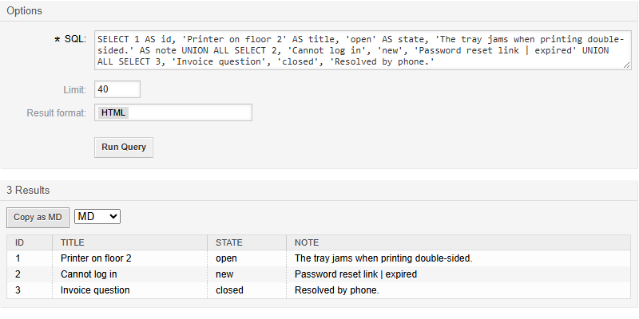

# SqlBoxCopy

A "Copy as ..." button for the SQL Box in the Znuny LTS 6.5 admin interface. It copies the query result as Markdown, TSV or JSON.

[](https://www.gnu.org/licenses/gpl-3.0)
[](https://www.znuny.org/)

> **Maintenance status:** This package is published as-is, in case it is useful to others. It is not actively maintained. Pull requests are not accepted. Questions and ideas are welcome in [Discussions](../../discussions); bug reports in Issues may go unanswered for a long time. You are welcome to fork it and make it your own (GPLv3).



## What it does

After a query has run in **Admin → SQL Box**, a button above the result table copies the whole result to the clipboard. A drop-down next to the button chooses the format (MD for Markdown, TSV or JSON). The choice is remembered in the browser.

The result is copied exactly as the SQL Box shows it, with these rules for every format:

- **Full values.** The SQL Box cuts every cell at 80 characters in the table but keeps the whole value in the cell's `title` attribute. The button copies the whole value.
- **The filter is respected.** Rows hidden by the "Filter for Results" box are left out. If the filter hides every row, nothing is copied and the button says so.
- **The button shows what it copied**, for example "Copied: Markdown, 3 rows".

## Formats

### Markdown (default)

Meant for pasting query results straight into Markdown tools such as Obsidian, Logseq, Joplin or Typora (documenting a finding, keeping a query and its result together), and into GitHub or Gitea issues. It can also be pasted into an LLM to have it explain, compare or post-process the data. For that, Markdown is a better format than a screenshot or copied HTML: it is compact, the values are exact, and each row stays one line.

```
|id|title|state|note|
|-|-|-|-|
|1|Printer on floor 2|open|The tray jams when printing double-sided.|
|2|Cannot log in|new|Password reset link \| expired|
```

`|` becomes `\|` and line breaks become `<br>`. `<`, `>` and `&` are left as they are, so HTML in a value stays readable.

When the query returns nothing, Markdown copies the query itself, the row count, the message Znuny shows and the column names, so the pasted text explains itself:

````
**Query result (no rows):**

```sql
SELECT 1 FROM ticket WHERE 1=0
```

Rows: 0
Message: No matches found.
Columns: 1
````

### TSV

Meant for spreadsheets: paste it into Excel or Google Sheets and every value lands in its own cell. The first line holds the column names. A cell that contains a tab, a line break or a double quote is wrapped in double quotes (with the quotes doubled), which is how spreadsheets expect such values. With no rows, only the header line is copied.

```
id	title	state	note
1	Printer on floor 2	open	The tray jams when printing double-sided.
2	Cannot log in	new	Password reset link | expired
```

### JSON

Meant for scripts (`jq`, Python) and for LLMs when exact values matter. It is a single line in the compact "columns and rows" shape:

```json
{"columns":["id","title","state","note"],"rows":[["1","Printer on floor 2","open","The tray jams when printing double-sided."],["2","Cannot log in","new","Password reset link | expired"]]}
```

- The column names appear once and not on every row, so the output is small. Duplicate column names (`SELECT a.id, b.id`) are kept, which an array of objects could not do.
- All values are strings, because the SQL Box page only shows text. The one exception is the text `NULL`, which becomes `null`. A real string "NULL" cannot be told apart from a database NULL and also becomes `null`.
- With no rows the output is `{"sql":"…","message":"No matches found.","columns":[…],"rows":[]}`.

## Requirements

- Znuny LTS 6.5.x. Running in production on 6.5.26. It has not been tested on Znuny 7.x.
- A modern web browser.

## Installation

Download `SqlBoxCopy-1.0.0.opm` from the Releases page. Install it from the command line and restart the web server so the new configuration is loaded:

```shell
sudo -u otrs /opt/otrs/bin/otrs.Console.pl Admin::Package::Install /path/to/SqlBoxCopy-1.0.0.opm
sudo systemctl restart apache2
```

Installing through **Admin → Package Manager** works as well. Remove the package with `Admin::Package::Uninstall SqlBoxCopy`. Uninstalling removes all files and the setting; the package creates no database tables and needs no manual steps.

To build the package yourself, point `--module-directory` at `src/` so the package contains the files in the repository and not whatever is already installed:

```shell
sudo -u otrs /opt/otrs/bin/otrs.Console.pl Dev::Package::Build \
    --module-directory /path/to/repo/src \
    /path/to/repo/src/SqlBoxCopy.sopm /output/dir/
```

## How it works

Two parts. No core file is changed or overridden. The package is client side only, with no database effect and no Perl code.

- `src/Kernel/Config/Files/XML/SqlBoxCopy.xml` registers the script for the SQL Box only, through the SysConfig setting `Loader::Module::AdminSelectBox###100-SqlBoxCopy`, the same mechanism core uses for `Core.Agent.Admin.SelectBox.js`.
- `src/var/httpd/htdocs/js/Core.Agent.Admin.SqlBoxCopy.js` is a Znuny JavaScript module. If the page contains the results table, it inserts the button and the drop-down above it. The page is also shown before any query has run, and then it does nothing.

Details:

- The result table has the id `Results`. Rows with a `colspan` cell are messages ("No matches found.", "Query is executed.") and not data. The hidden `FilterMessage` row that the filter box adds is excluded from that check, because it says nothing about the query.
- Hidden rows are found with `getClientRects()` rather than by looking for a class name, so the button follows whatever way core uses to hide rows.
- The query text in the no-rows output is read from the SQL field when you click. If you edit the field after running the query and before clicking, the edited text is copied.
- The chosen format is kept in `localStorage` under `SqlBoxCopyFormat`. If the browser blocks storage, the choice simply resets to Markdown on the next page.
- The text is copied with `navigator.clipboard`, with a `document.execCommand('copy')` fallback for pages without a secure context.
- The package description in Admin → Package Manager is available in Swedish, English, German, Spanish, Portuguese, Italian and French. The German, Spanish, Portuguese, Italian and French texts were machine translated and have not been reviewed by a native speaker. The button and its messages are in English only.

## AI assistance

SqlBoxCopy was written with Claude Code (Anthropic) as a pair-programming assistant: the design, the JavaScript code and this documentation were drafted together with it.

The maintainer reviewed every change and is responsible for the result. There is no unit test. The package runs in production on Znuny 6.5.26 and was verified manually there. It has not been tested on Znuny 7.x.

## Licence

Copyright (C) 2026 Katla

GNU General Public License, version 3. See [COPYING](COPYING).
